

  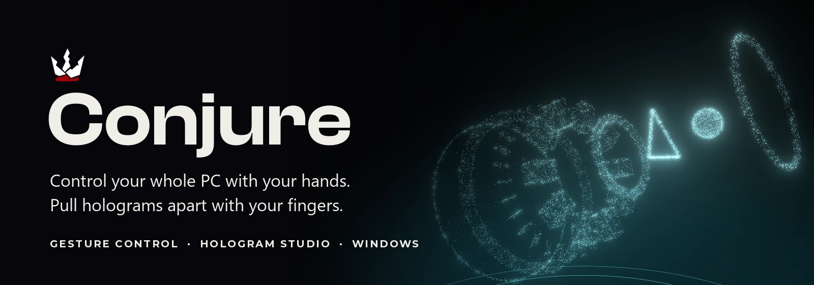

  <b>A Windows app that watches your webcam and turns your hands into a remote control for the whole computer, with a hologram studio inside it that you take apart with your fingers.</b>

  
  
  
  
  

> **This is a showcase.** The source code is private. Every picture and clip below is cut from one real screen recording of the app, with my own hands, no mock-ups.

---

## Watch the tour

[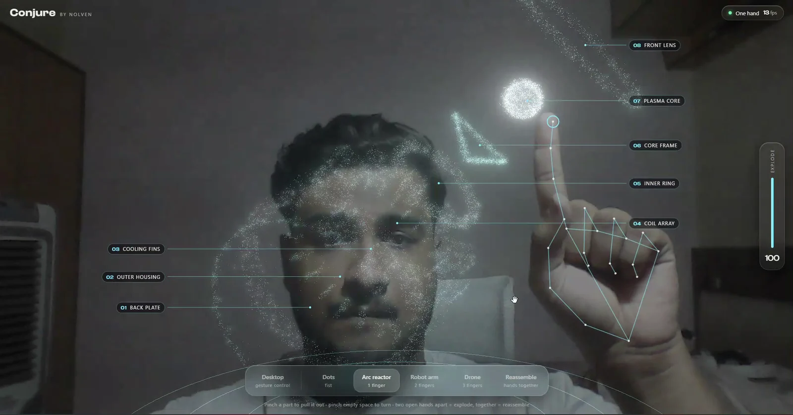](video/Conjure-tour.mp4)

**About 2 minutes, one real take.** Click the picture to play. Every gesture you see is live: the red boxes are the app reading my hands in real time.

---

## Your hands run the PC

Desktop mode puts a red-and-white heads-up display over your camera. These are the gestures, each cut from the real recording.

<table>
<tr>
<td width="50%" valign="top">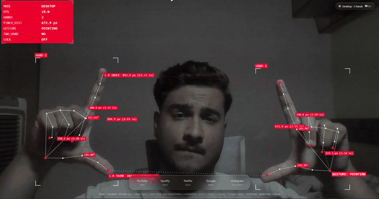 <b>Make a frame with both hands</b> Hold still for a second and it screenshots exactly that part of your real screen.</td>
<td width="50%" valign="top">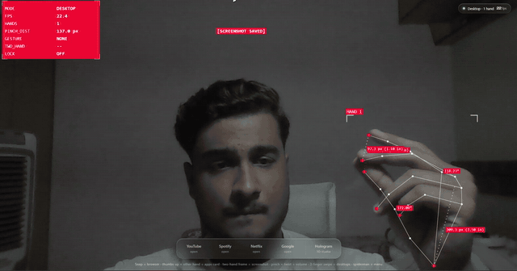 <b>Snap your fingers</b> The browser opens, with a ring that expands from your fingertips.</td>
</tr>
<tr>
<td width="50%" valign="top">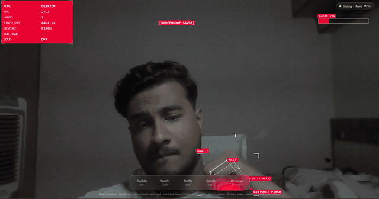 <b>Thumbs up, then point</b> A card of apps appears. Hold your other fingertip on one and it opens.</td>
<td width="50%" valign="top">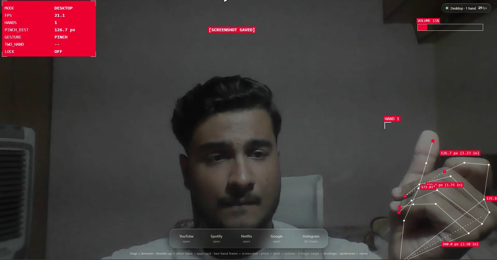 <b>Pinch and twist your wrist</b> Like turning a knob. The volume bar follows your hand.</td>
</tr>
</table>

<b>More from the real run</b>

| | |
|---|---|
| 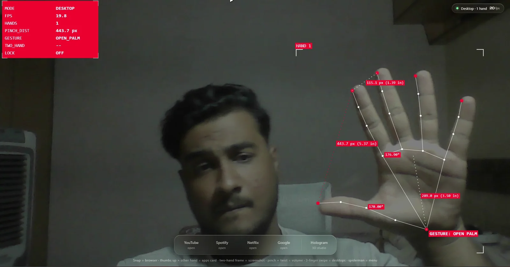 | 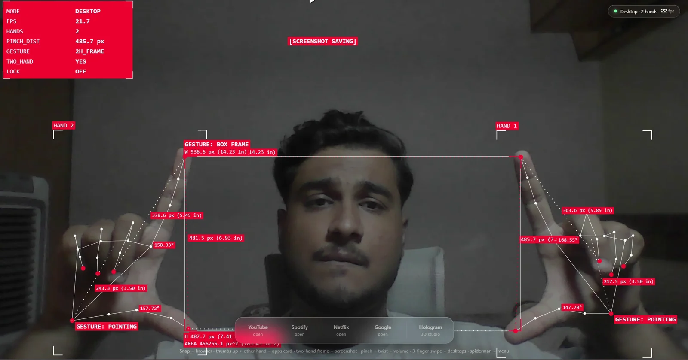 |
| **21 points on each hand**, tracked live, with distances and angles read out | **The frame gesture**, with its size measured and the screenshot confirmed |
| 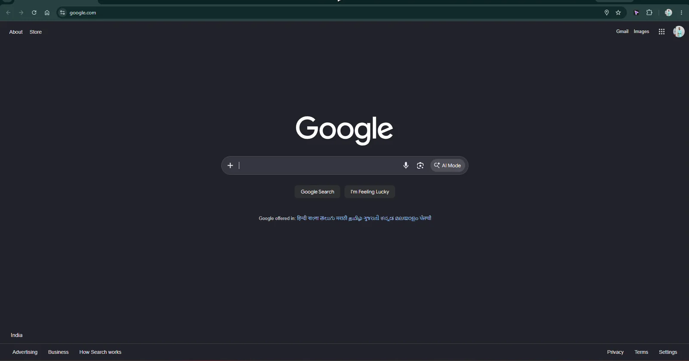 | 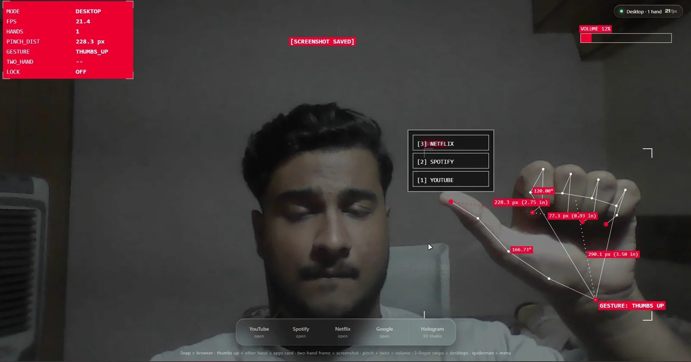 |
| **What a snap does**: the browser opens | **The apps card**: YouTube, Spotify, Netflix |

Also built into Desktop mode: three fingers swiped sideways to switch Windows desktops, a Spiderman-sign radial menu, an **air mouse** (your hand moves the real cursor, pinch to click, hold to drag, two fingers to scroll), a see-through **overlay** that floats the HUD over your actual desktop, **object detection** with a line from each object to your fingertip, and a **phone-as-camera** button. A **Lock** switch turns every real-world action off. These are built but are not in the recording above.

---

## Hologram studio

Hold up 1, 2 or 3 fingers and a cloud of **26,000 floating dots** pulls together into a machine. Pull both hands apart and it explodes into its named parts. Pinch a part to take it out and put it anywhere.

<table>
<tr>
<td width="33%" valign="top">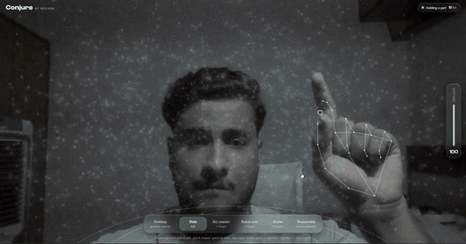 <b>1 finger: arc reactor</b> 8 named parts</td>
<td width="33%" valign="top">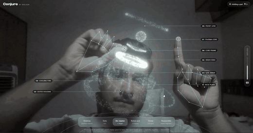 <b>Pinch a part out</b> It follows your fingers</td>
<td width="33%" valign="top">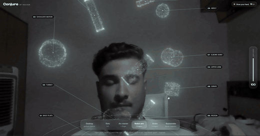 <b>3 fingers: drone</b> 8 named parts</td>
</tr>
</table>

| | | |
|---|---|---|
| 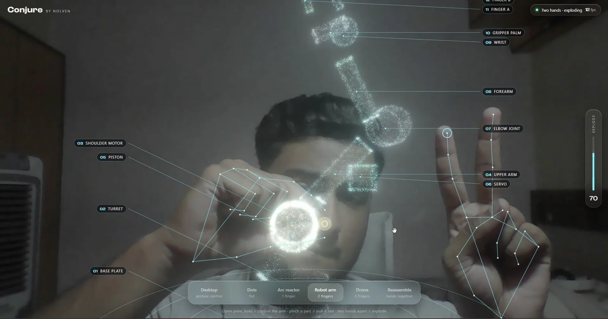 | 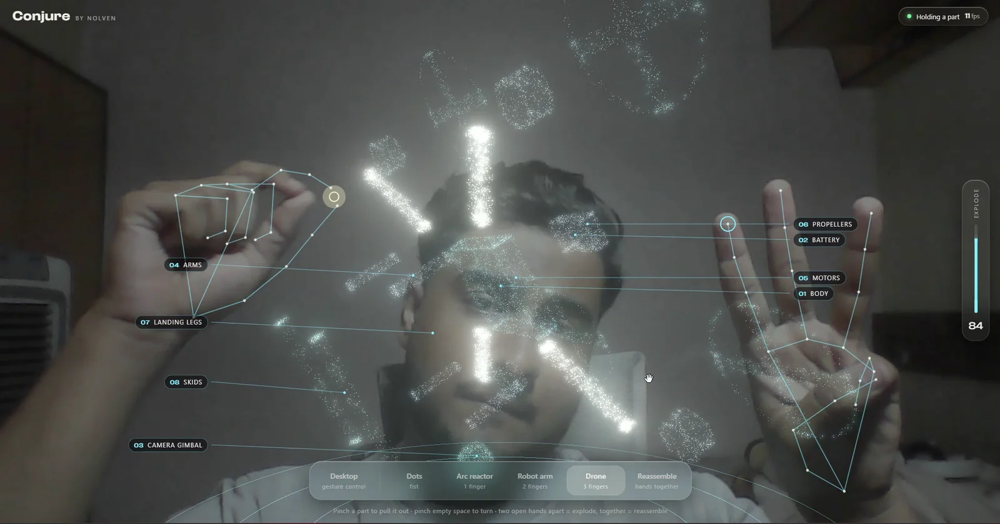 | 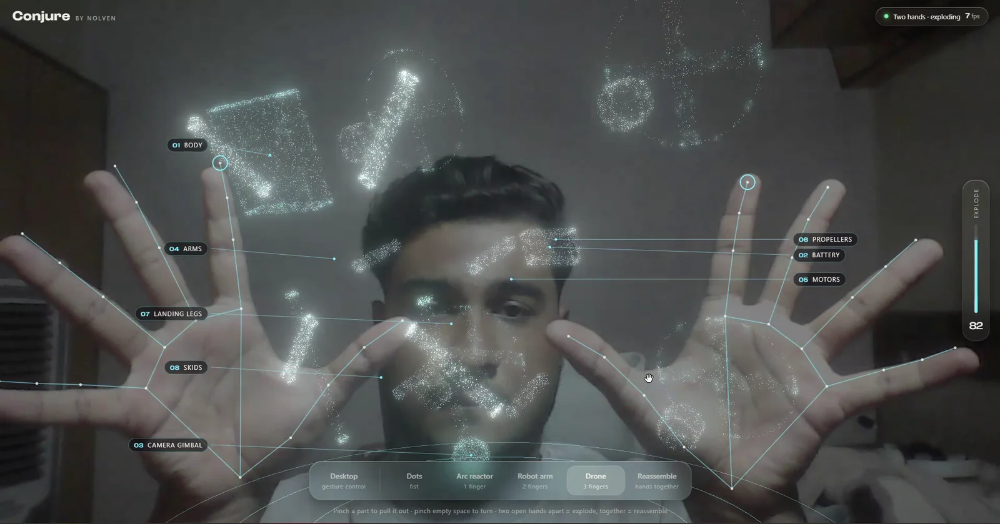 |
| **2 fingers: robot arm.** 12 named parts. Hold an open palm and the arm follows your hand like a real arm. | **Pull the parts out.** Every one is labelled. | **Two open hands apart** explode the whole machine. |

  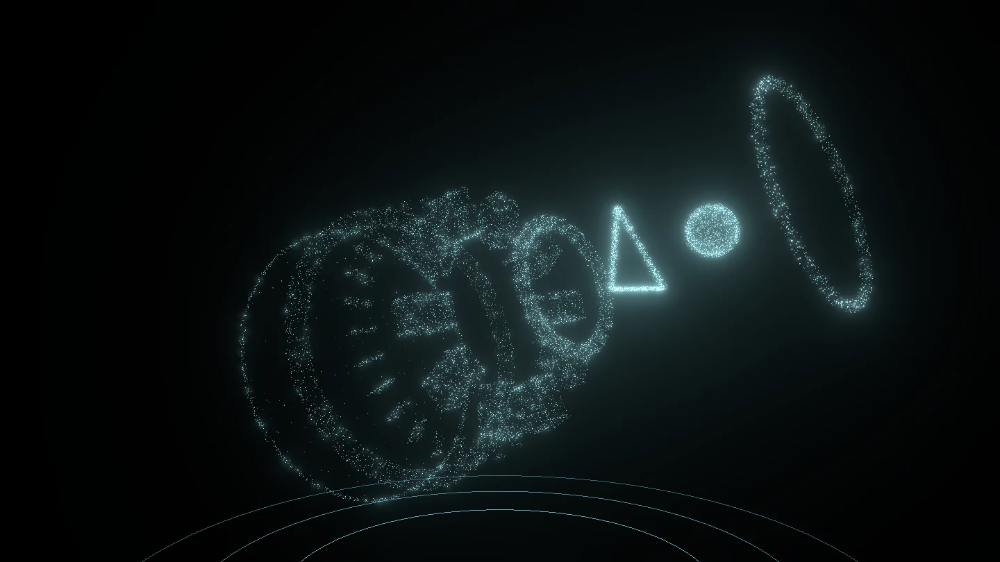

---

## How it fits together

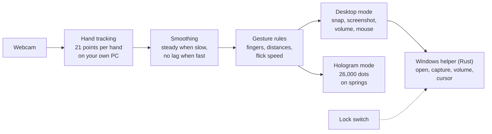

1. **Hands to numbers.** A hand-tracking model finds 21 points on each hand. It runs on your own PC, and the video is never recorded or sent anywhere.
2. **Steady, not laggy.** Each point is smoothed with a filter that holds still when your hand is slow and adds no delay when it is fast.
3. **Rules, not guesses.** Which fingers are up, how close the fingertips are, how fast a flick is: all measured in hand sizes, so it works near or far from the camera. These rules are a port of my earlier Jarvis gesture tracker.
4. **A small Windows helper** written in Rust does the real-world part: opening links, saving the screenshot, setting the volume through Windows, moving the mouse.
5. **Dots on springs.** Each of the 26,000 dots is pulled toward its place by a spring. Switch machines and they burst out and swirl into the new shape. The robot arm is a real two-joint arm, so your hand decides where the gripper goes and the shoulder and elbow work themselves out.

## By the numbers

| | |
|:---:|:---:|
| **26,000** dots, each on its own spring | **28** named parts across 3 machines |
| **21** tracked points on every hand | **0** servers: it all runs on the PC |
| **16 MB** one Windows installer | **10** real-world actions, with a Lock switch |

## Honest status

A first version, built and working. The gesture thresholds come from my earlier tracker and will want tuning for other hands, rooms and cameras. Windows only, and the installer is unsigned, so Windows SmartScreen asks you to confirm on first run.

## Built with

MediaPipe (hand and object detection) · Three.js (the dots and the glow) · Tauri and Rust (the Windows app) · plain JavaScript.

---

Built by <b>Khushal Vashistha</b> · <a href="https://nolven.co.in">nolven.co.in</a>

